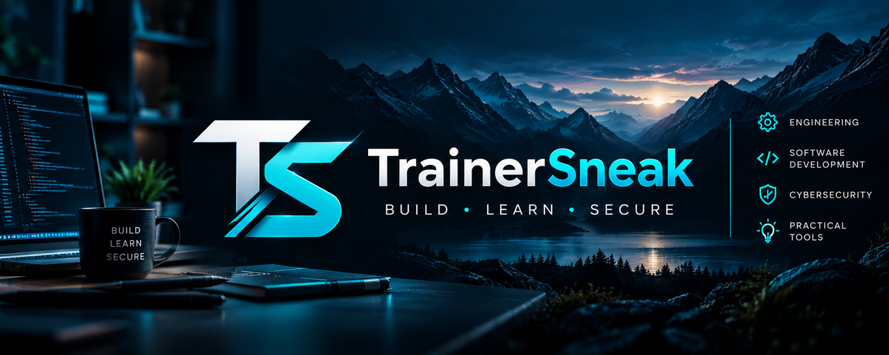

  

# Hi, I'm TrainerSneak 👋

**Engineering × Software Development × Cybersecurity**

I'm an engineering professional who likes understanding how systems work, building practical tools, and improving everyday workflows. I share selected software projects and document what I'm learning along the way.

### 🔧 What I'm building and learning

- **Software & automation:** Windows desktop tools, Python, Flask, SQLite, and Excel-based workflows.
- **Engineering:** practical problem-solving, maintenance workflows, technical documentation, and CAD learning.
- **Cybersecurity:** networking, Linux, PowerShell, operating-system fundamentals, and hands-on practice in authorized labs.
- **Product improvement:** designing, testing, refining, and documenting useful applications.

### 🚀 Featured project

**[Personal Time Tracker — Windows beta](https://github.com/TrainerSneak/personal-time-tracker-releases)**

A local Windows application for tracking work, study, and other activities, with activity timers, a floating timer, session history, and reports.

> **Beta notice:** This is unsigned Windows beta software with known unresolved dependency security findings. Please read the project's [installation guide](https://github.com/TrainerSneak/personal-time-tracker-releases/blob/main/INSTALLATION.md) and [known issues](https://github.com/TrainerSneak/personal-time-tracker-releases/blob/main/KNOWN_ISSUES.md) before testing. Its application source remains private; the public repository hosts release information and feedback.

[Explore the release repository](https://github.com/TrainerSneak/personal-time-tracker-releases) · [Share feedback](https://github.com/TrainerSneak/personal-time-tracker-releases/issues)

### 🧰 Technologies & interests

`Python` · `Flask` · `SQLite` · `Windows` · `Git & GitHub` · `Excel` · `Linux` · `PowerShell` · `Networking` · `AutoCAD / Plant 3D`

### 🎯 How I approach projects

**Investigate → Plan → Build → Test → Improve → Document**

I value practical experiments, clear documentation, and continuous learning.

---

<strong>Build • Learn • Secure</strong>

Only selected, approved work is shared publicly. Private development code and employer/customer information are not published here.
